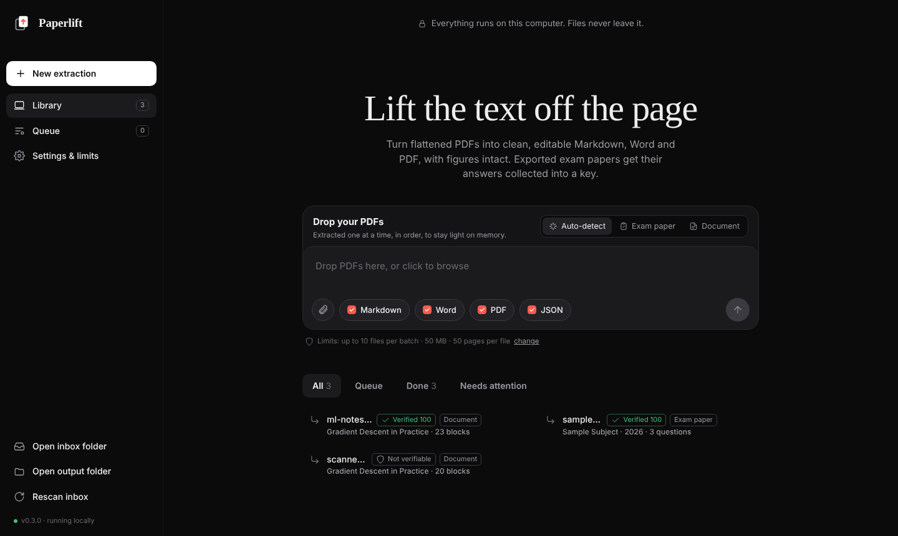
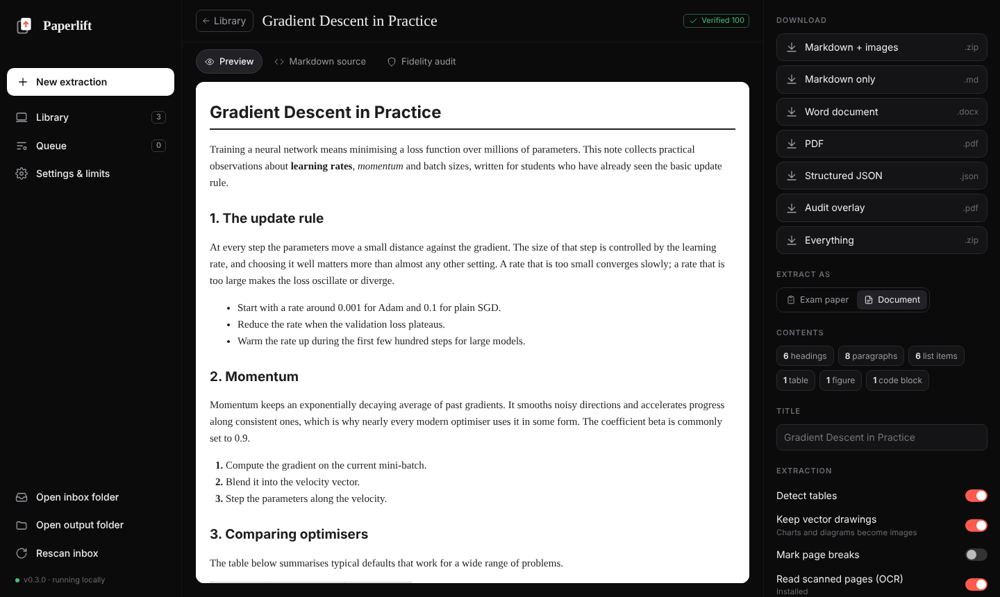
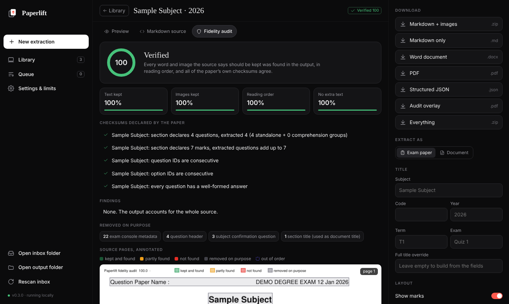
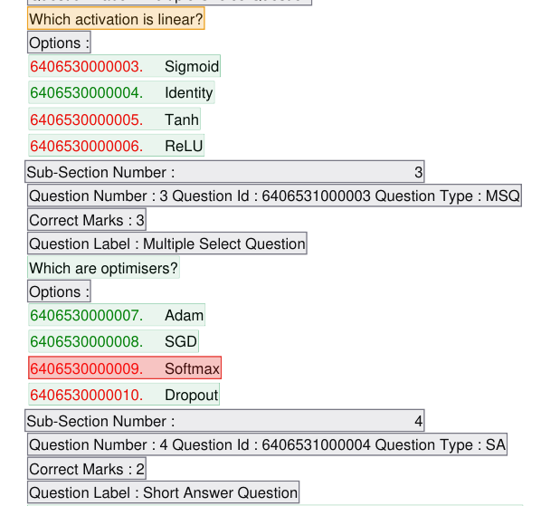
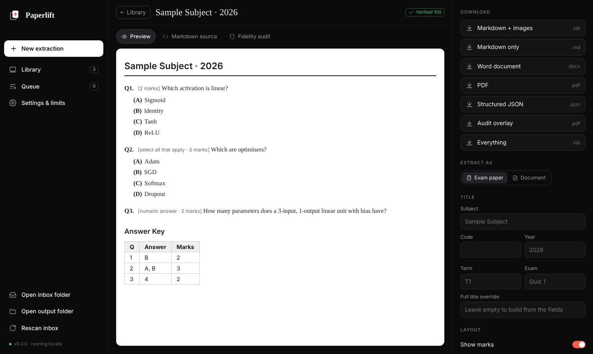

<p align="center">
  
</p>

<h1 align="center">Paperlift</h1>

<p align="center">
  <b>Lift clean, editable documents out of flattened PDFs, and prove nothing was lost.</b><br>
  Markdown, Word, PDF and JSON, with figures intact. Every conversion is checked against the source.<br>
  Runs entirely on your computer.
</p>

<p align="center">
  <a href="../../actions/workflows/ci.yml"></a>
  
  
  
</p>

<p align="center"></p>

---

## Why

Exported and "flattened" PDFs look fine but are painful to reuse: text is split
into fragments, equations are pictures, columns interleave, and every page
repeats a header. Paperlift rebuilds the document structure so you get a file you
can actually edit.

It has two profiles and picks the right one per file automatically:

| Profile | For | What you get |
|---|---|---|
| **Document** | any PDF with a text layer: notes, handouts, reports, papers, slides exported to PDF | headings, paragraphs, bullet and numbered lists, tables, code blocks, figures (raster and vector), inline images, correct two-column reading order, running headers / footers / page numbers removed |
| **Exam paper** | exported online-exam papers (IITM BS-style: question and option IDs, green/red marked answers, console metadata) | compact question paper: subject + code + year title, numbered questions, (A)–(E) options, shared comprehension passages, math kept inline, and an **answer key at the end** |

Scanned pages are kept as images, or read as text with the optional OCR add-on.

<p align="center"></p>

## Fidelity audit: every conversion checks itself

Converters usually fail silently: a dropped line, a lost option or a duplicated
paragraph goes straight into your notes. Paperlift checks its own output with
no reference answers needed. A flattened PDF still contains an exact text layer
and its original images. That says nothing about structure, but it says exactly
what content must survive. So every word and image on the page is accounted for:

- **kept**: it must appear in the output exactly once, in an order the page
  layout requires;
- **removed on purpose**: with a stated reason (console metadata, running
  footer, page number…), listed for you to see.

Exam papers are also checked against **their own built-in checksums**:
- the declared number of questions;
- the declared section marks;
- question IDs and option IDs, which must form unbroken sequences (each
  short-answer question uses up exactly one option ID);
- one marked answer per multiple-choice question.

<p align="center"></p>

Each file gets a fidelity score and a verdict: *Verified*, *Minor
differences* or *Needs review*. You also get a list of findings with page
numbers, and the source pages annotated in colour:

<p align="center"><br>
<sub>An injected fault on a synthetic paper: a deleted option (red) and two lost words (amber).</sub></p>

**How well does it work?** We tested 9 documents and about 2,700 deliberately
corrupted extractions:
- 0 false alarms on clean extractions;
- 99–100 % of lost, duplicated or altered words, options, questions, images and
  table rows detected;
- 99.1 % of detectable reading-order swaps detected.

The method, the maths, the benchmark and its limits are written up in
**[docs/RESEARCH.md](docs/RESEARCH.md)**. It checks content and order, not
structure: a heading turned into a paragraph is outside what it can see.

```bash
./paperlift.sh audit paper.pdf --overlay ./audit     # report in the terminal + annotated PDF
python bench/fault_injection.py                      # reproduce the benchmark
```

## Quick start

**macOS:** download or clone, then double-click **`Start Paperlift.command`**.
The first time, macOS may block it; right-click → Open instead.

**Linux:**

```bash
git clone https://github.com/1mystic/paperlift.git
cd paperlift
./paperlift.sh
```

Your browser opens at `http://127.0.0.1:8765`. Drop PDFs, pick formats, done.

### Everything stays in the folder

The first start downloads [uv](https://github.com/astral-sh/uv), a private
Python 3.12 and the dependencies into **`.runtime/`** inside the project
(about 240 MB, internet needed once). Nothing is installed system-wide, nothing
is written to your home folder, and no `sudo` is needed. You only need `bash`
and `curl` or `wget`.

```bash
./paperlift.sh reset     # delete .runtime (rebuilt on next start)
./paperlift.sh update    # reinstall dependencies
./paperlift.sh ocr       # add OCR for scanned PDFs (~150 MB more)
```

To uninstall, delete the folder.

### Or install it as a command

```bash
uvx --from git+https://github.com/1mystic/paperlift paperlift   # run without installing
pipx install git+https://github.com/1mystic/paperlift            # or install the `paperlift` command
```

When installed this way, files live in `~/Paperlift/` (override with `PAPERLIFT_HOME`).

## Command line

```bash
./paperlift.sh convert ~/Downloads/*.pdf                     # auto-detect each file
./paperlift.sh convert notes.pdf --mode general --page-markers
./paperlift.sh convert paper.pdf --mode qpaper --code CS3004 --exam "Quiz 2"
./paperlift.sh convert inbox/ -o ~/Desktop/clean --formats md,docx
./paperlift.sh convert big.pdf --max-pages 300               # raise a limit for one run
./paperlift.sh detect *.pdf                                  # show which profile each file gets
./paperlift.sh audit *.pdf --overlay ./audit                 # verify extractions, save annotated PDFs
./paperlift.sh serve --port 9000 --no-browser
```

You can also copy PDFs into `inbox/` and choose **Rescan inbox** in the app.

## Output

Each file gets a folder in `output/<name>/`:

```
output/ml-notes-week3/
├── ml-notes-week3.md              Markdown, images referenced from images/
├── ml-notes-week3_markdown.zip    the .md plus only the images it uses
├── ml-notes-week3.docx            Word, images embedded
├── ml-notes-week3.pdf             clean re-typeset PDF
├── ml-notes-week3.json            structured blocks / questions
├── ml-notes-week3_audit.pdf       source pages annotated by the fidelity audit
├── _audit.json                    the audit report
└── images/
```

<p align="center"></p>

Exam papers with several subjects produce one set of files per subject. You can
edit the title fields, choose sections and toggle marks or renumbering, then
re-extract.

## Built for modest machines

- **One file at a time.** A single background worker processes the queue, so
  memory stays flat however many files are waiting. Caches are flushed after each file.
- **Limits** (Settings → Limits, or CLI flags): **10 files per batch, 50 MB
  per file, 50 pages per file** by default. Use `0` for no limit. Oversized files
  are rejected at upload with a clear reason.
- Uploads stream to disk, pages are processed one by one, images go straight to
  disk, and the server lowers its own CPU priority.
- The server uses only Python's standard library, and the UI is one HTML file
  that works offline.

## How it works

- **Exam papers.** Text spans and embedded images are clustered into visual
  lines, then a state machine reads the console layout: question headers,
  `Options :`, option IDs (green = correct, red = wrong), `Possible Answers :`,
  comprehension groups and section titles. All console metadata is discarded.
  Equation images are cropped and kept inline.
- **Documents.** A first pass learns the body font size, heading sizes and the
  lines repeated in page margins. A second pass finds tables
  (`find_tables`), raster figures, vector drawing clusters (rendered as
  figures), and text blocks. It then orders them column by column and classifies
  headings, list items, code and paragraphs, joining hyphenated words and
  paragraphs split across pages.
- **Fidelity audit.** Source text is split into units with a fate (kept, or
  dropped with a reason). Kept tokens are matched to the output by a
  one-to-one, consumption-based k-gram alignment. The audit then computes text
  and image recall, precision and pairwise order agreement on layout-determined
  pairs. Exam papers add five document-declared checksums. See
  [docs/RESEARCH.md](docs/RESEARCH.md).
- **OCR** (optional) uses [RapidOCR](https://github.com/RapidAI/RapidOCR) on
  ONNX Runtime with the same column-aware grouping. It runs locally, with no cloud.

## Limitations

- Equations stay images. They are not converted to LaTeX or editable Word equations.
- The fidelity audit verifies content and order, not structure, and it cannot
  check scanned pages (they have no text layer). A moved answer mark keeps the
  answer count intact, so it is not caught.
- Complex layouts (magazine spreads, tables without ruling lines, forms) may
  need manual touch-up. Tables inside scanned pages become plain text.
- The exam-paper profile targets one export layout. Other exam formats fall
  back to the Document profile; contributions of new profiles are welcome.
- No Windows launcher yet. The `pip`/`uvx` install route works there.

## Contributing

See [CONTRIBUTING.md](CONTRIBUTING.md). Run the tests with:

```bash
.runtime/bin/uv pip install --python .runtime/venv/bin/python pytest
.runtime/venv/bin/python -m pytest -q
```

Tests build their own synthetic PDFs (`tests/fixtures.py`), so no real documents
are stored in the repo.

## License

Copyright (C) 2026 Atharv Khare. Licensed under [AGPL-3.0-or-later](LICENSE). Paperlift is built on
[PyMuPDF](https://github.com/pymupdf/PyMuPDF), which is AGPL-licensed, so
Paperlift uses the same license.
